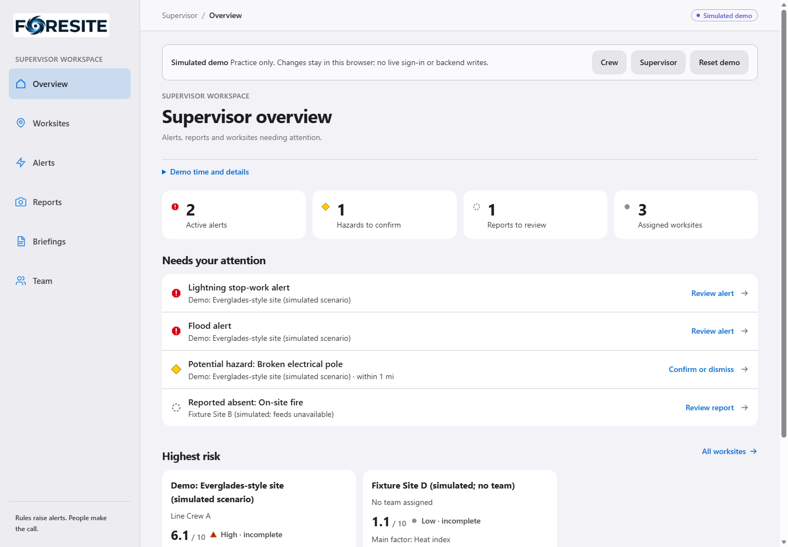
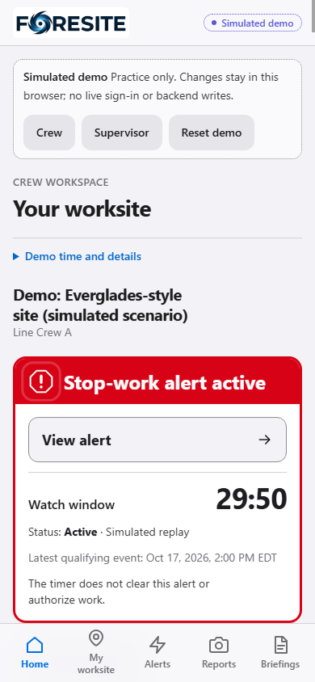
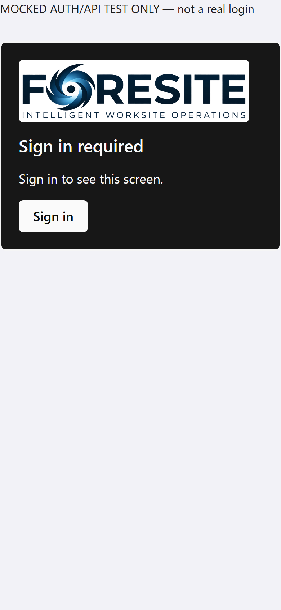

# Official FORESITE logo integration

The approved source is the supplied blue cyclone inside the O of **FORESITE**, with
the tagline **INTELLIGENT WORKSITE OPERATIONS**. No replacement icon or redraw.
Branch `feature/cache-official-foresite-logo` starts at main `991c52f`, after the
maintainers merged the text rebrand (PR51) and feed work (PR50).

## Artwork and extraction

`frontend/public/foresite-logo.png` is the provided **2172×724 RGBA PNG**, copied
byte-for-byte from the attached Downloads file. SHA-256:
`56ddbbb30501102a1700f57510feb5a18db2cbcb588e55bd558f42128ea5617d`.
The request's public target was initially absent; the already supplied source was
available, so no new upload or substitute artwork was needed.

| Asset in `frontend/public/` | Size | Use |
|---|---:|---|
| `foresite-logo.png` | 2172×724 | Unmodified approved source |
| `foresite-logo-full.png` | 1200×300 | Trimmed full logo/tagline, footer and access screens |
| `foresite-wordmark.png` | 768×166 | Navigation wordmark without tiny tagline |
| `foresite-cyclone.png` | 384×384 | Extracted cyclone, compact Logo export |
| `foresite-favicon-16.png`, `foresite-favicon-32.png` | 16/32 | Browser favicons |
| `foresite-favicon.ico` | 16/32/48 | Multi-resolution browser icon |
| `foresite-apple-touch-icon.png`, `foresite-icon-192.png` | 180/192 | Mobile/home-screen imagery |
| `foresite-social.png` | 1200×630 | Full artwork on a white metadata-preview surface |
| `foresite-brand-assets.json` | JSON | Source/output hashes, crop coordinates and dimensions |

Derived logos retain transparent backgrounds and original colors. The social image
is deliberately a white presentation surface, not a recolored logo variant. The
cyclone is isolated from the neighboring F using its connected alpha component;
faint original antialiased edges are retained. Crop/contain/Lanczos resizing preserves
proportions, without drawing new paths or replacing the approved symbol. Insignificant
near-transparent speckles outside the artwork are excluded by tight crop boundaries.
The source itself is untouched.

No faithful editable vector source was supplied. Automatic tracing would approximate
the artwork's gradients/texture, so no SVG conversion or raster-in-SVG wrapper is claimed.
Navigation uses the compact raster at several times its CSS display size; the large
source is not downloaded merely to render a small header mark.

## Components and placement

`frontend/src/components/shell/Brand.tsx` is the single display implementation:

```tsx
<Brand variant="compact" /> // header/sidebar, default width 160 CSS px
<Brand variant="full" />    // tagline where there is room, max width 320 CSS px
<Brand variant="icon" />    // compact cyclone, default 32 CSS px
```

It declares intrinsic image dimensions, preserves aspect ratio, bounds width and
provides meaningful alt text. The sidebar link already has an accessible name and
uses a decorative image to avoid redundant announcements. A dark-mode white contrast
plate preserves the approved navy lettering rather than recoloring the artwork.

- AppShell: same compact wordmark in Crew/mobile header and Supervisor sidebar;
  existing desktop breadcrumbs retained; full logo/tagline in the existing footer.
  Branding is not repeated in dashboard cards or every mobile navigation item.
- Icon's existing `Logo` export delegates to the cyclone variant for compatibility;
  the old octagon/bolt branding render is removed. Operational alert/navigation icons
  remain intact and separate from branding.
- App-owned sign-in/loading/no-role/denied panels use the full logo. `showBrand` is a
  presentation-only optional prop on RequireRole; embedded guards in the development
  sign-in-check page omit duplicate logos because that page has its own full logo.
  Authentication conditions, actions, context and tokens are unchanged.
- Both HTML entrypoints reference cyclone favicons. Main metadata includes the
  full-logo social image. The tab title remains exactly **FORESITE**.

All new image/favicons use `?v=56ddbbb3`, tied to the approved source hash. New asset
URLs replace `/planit-mark.svg`; that historical file remains for compatibility but
is no longer referenced by active frontend source/entrypoints. There is no new web
app manifest or deployment/cache-policy change.

## Reproduce assets (optional, development only)

Assets are committed. Running the application or deploying requires **no Pillow or
Python asset generation step**. For an intentional regeneration from the approved
source, from repository root in Windows PowerShell:

```powershell
python -m venv frontend\.shell-check\logo-tools
.\frontend\.shell-check\logo-tools\Scripts\python.exe -m pip install Pillow==13.0.0
.\frontend\.shell-check\logo-tools\Scripts\python.exe frontend/scripts/prepare-brand-assets.py
```

The script checks the source hash/dimensions and expected cyclone component before
producing assets. Regeneration here was byte-identical; transparency and embedded
ICO sizes were checked. Pillow was installed only in this new ignored tool environment;
no existing environment, frontend dependency, manifest or lockfile was altered.

## Verification and screenshots

- Frontend lint, explicit TypeScript check and **171 existing frontend tests pass**.
- Default/live-mode and explicit-demo production builds pass. The existing default
  bundle-size warning remains; no bundle policy was changed to hide it.
- Installed-Edge development browser suite passes: all eleven destinations at
  **1440, 768, 390 and 320 CSS pixels**, with loaded official images, matching aspect
  ratios, accessible names, no overflow and existing touch/keyboard checks.
- Browser checks load and verify actual 16/32 favicon, 180 touch-icon and 1200×630
  metadata images. Mock sign-in screenshots exercise light/dark appearance at DPR2.
  Assets at 16/32 and larger sizes were also inspected on light/navy surfaces.
- Existing 6.1/10 rules-0.2, six event cards, alerts/acknowledgement, report/photo,
  confirmation/instruction, team/code and briefing flows remain in the smoke suite.
  These are demo/mock checks, not a new real-service acceptance claim.
- The first browser attempt found no server on 5177. A new explicit demo Vite instance
  was started only from the functional checkout (PID 25276); no process was stopped.
  No backend or background job was started. The demo is http://localhost:5177/.
- The built-demo suite also passes all eleven destinations at the same four widths,
  asset checks and lifecycle assertions, with zero browser exceptions/real API calls.
  Its temporary preview server on 5182 was closed; the demo on 5177 remains available.
  Dev/built checks finished at 21:21/21:23 EDT on 2026-10-17. Backend files were not
  changed and the backend suite was not rerun for this frontend-only logo task.

Focused commands, from `frontend` with the existing Node 24 environment:

```powershell
npm.cmd run lint
node node_modules/typescript/bin/tsc -b --pretty false
node --test tests/*.test.mjs
npm.cmd run build
node scripts/check-shell.mjs http://localhost:5177/
```

The built-demo check uses `VITE_USE_FIXTURES=true` for its build process, outDir
`.shell-check/official-logo-dist`, then the same checker with `--production` against
an isolated Vite preview. No `.env` file is edited. Latest main advanced to `6aa528b`
during verification with deployment-only files; those owner changes do not overlap
this PR and are left untouched.

Review images (public simulated data; no real accounts or private photos):





Light sign-in and asset-size/contrast contact sheet are also in `docs/branding/`.

## Auth0 and Vultr handoff

**Braydin:** Auth0 Universal Login is hosted outside the app. If desired, publish
approved logo imagery at a URL accessible to that page and coordinate its branding
through the existing tenant administration process. Review crop/contrast on that
external page. No tenant, client, audience, roles, callbacks or auth settings were
changed or verified with real sign-in here.

**Deployment owner:** normal frontend build/deploy copies the committed public assets.
No Python generation, new environment variable, hostname, DNS, backend release,
migration or infrastructure/workflow change is required for this logo feature.
Ensure the new HTML and assets are released together. If old HTML/favicon remains
cached, use the existing owner-controlled cache refresh/hard reload procedure.
Verify social-preview resolution on the deployed origin; no crawler/share scrape or
external Auth0 branding update is claimed by local browser checks.

Rudra reviews the limited visual placement; Braydin reviews auth-screen presentation.
No backend/API/schema, score/ML/Gemini, report/photo handling, role policy or deployment
file changed. No task checkbox changed and no automatic merge/deployment.
