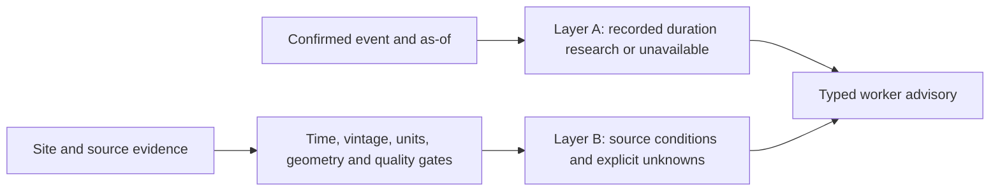

# Worker advisory slice, contract 2.0.0

`build_worker_outlook(event_context, site_context, evidence)` connects the preserved regional duration research to source-grounded local environmental context. It is a separate Cache-owned library and offline harness. It adds no production route, frontend switch, database import, alert logic, or score contribution.



Layer A probabilities never become Layer B hazard probabilities. There is no joint probability or worker injury model. `not_work_clearance=true`, `research_only=true`, and both operational/production eligibility flags are constrained false by the output schema.

## Reproduce the independent slice

From the repository root, in PowerShell:

```powershell
./ml/setup.ps1 -ProvisionModel
$MlPython = ".\ml\.venv\Scripts\python.exe"
& $MlPython -m ml.provision_expansion --download
& $MlPython -m ml.demo_worker_outlook --require-models
```

The last line is the one-command offline demo once provisioned. It makes no network calls, fits no models, validates five complete outputs, and writes `ml/reports/worker_outlook/demo_outputs.json` locally (ignored) plus checked compact summaries. Canonical requests/responses and generated JSON schemas are in `ml/fixtures/worker_outlook/`. `--export-examples` intentionally updates those checked examples; `--benchmark` measures 100 warm calls/case. Tests use temporary output directories and do not overwrite examples.

A clean checkout must provision the existing duration artifacts from their pinned NOAA/station sources. Missing/corrupt artifacts return unavailable Layer A while source conditions remain available. `--require-models` intentionally fails the demo if the two main examples lack their expected duration research. Recreate the process/adapter after provisioning; models and reviewed fit metadata are cached per process.

For all checks, install backend development dependencies too:

```powershell
& $MlPython -m pip install -r backend/requirements-dev.txt
& $MlPython -m pytest ml/tests backend/tests -q
& $MlPython -m ml.worker_research
```

This push additionally created a new isolated Python 3.14.5 environment, installed the pinned ML and backend requirements, and ran the full suite there. Existing model SHA-256/reference checks passed without refitting. See [validation.json](reports/worker_outlook/validation.json) for exact commands/results and [demo_runtime.json](reports/worker_outlook/demo_runtime.json) for measured cold/warm costs. No new multiprocessing or overlapping full backtests were used.

## Source coverage and example truth

Read [DISASTER_COVERAGE.md](DISASTER_COVERAGE.md) and [source_catalog.json](source_catalog.json). The all-category census covers 349,030 NOAA rows and 54 verbatim types, without treating all types as predictive support. Reporting group counts are not verified independent disaster counts. Existing model gates, including disabled Strong Wind/Ice Storm/Heavy Snow, are unchanged.

EIA-860M August 2026 supplied 28,379 generator rows, 14,700 validated unique plant locations, and 50 exported representative locations. The two demo sites are `eia-59769` (TIA Solar, Florida) and `eia-58708` (Phoenix Airport East Economy Lot, Arizona). These are real public plant coordinates, not verified active construction sites. This research export does not complete the team's backend database/site import task.

The real evidence snapshot is fixed at **2026-10-17T05:42:44.000015Z**. NWS station observations and actual issued hourly forecasts were retrieved for both locations. CO-OPS, USGS earthquake, NDBC, and SWPC probes were also retrieved. Broad catalog evidence does not become site exposure: the exported demo input retains local NWS/CO-OPS variables; remote buoy/quakes remain catalog probes. NWS forecasts preserve actual run-generation/update time, future valid intervals and source polygons. Only explicit windows 0/6/12/24 and latest local variables are exported; gaps are unknown, never interpolated.

**The event activation contexts are hypothetical replay fixtures.** Real weather readings are not evidence that a flood or high-wind disaster was actually occurring at either plant. The compound warning and local earthquake example are explicitly synthetic too. Every output is labeled demo/simulated, while individual source evidence distinguishes real captured readings from fixtures.

| Case | Layer A | Layer B |
|---|---|---|
| Real Tampa-area weather + hypothetical Flood | Existing conditional KM duration | Local observations and issued rain/wind/temperature/RH windows; no local flood-depth estimate |
| Real Phoenix-area weather + hypothetical High Wind | Existing conditional KM duration | Local observations and issued wind/thermal windows; no damage or injury probability |
| Deliberately mismatched evidence | Duration can remain available | No eligible site condition; unknown is not low risk |
| Compound tropical/rain/wind context | Tropical evolution unavailable | Real weather plus labeled synthetic flood warning; no independence multiplication |
| Synthetic nearby earthquake | Evolution unavailable | Labeled magnitude/epicenter context; local shaking and structural state unknown |

CO-OPS humidity was unavailable. Its receipted error is not a measurement. The preliminary coastal water reading has a quality flag and is rejected, rather than reported as zero water hazard. Actual gauge-to-site basin/datum validation remains a dependency.

## Contracts and methods

`ml/worker/schema.py` publishes `WorkerOutlookRequest`, `WorkerOutlook`, `SiteContext`, `Evidence`, `EvidenceAssessment`, and specialized condition types. Runtime input/output use the same Pydantic models as the generated `worker_request.schema.json` and `worker_outlook.schema.json`. Legacy `predict_active_event`, `predict_site`, `ActiveEventPredictor`, and their 1.1 contract remain intact.

`Evidence` carries stable ID, publisher, public origin URL, source record/type, value/unit, source version, location/coverage precision, observed/issued/available/valid/ingested times, availability basis, QC/missingness, and fixture state. Origin URLs exclude credential/query material; reviewed receipts retain complete public request URLs and hashes. Explicit UTC timestamps are mandatory.

`observed` means source measurements; `issued_forecast` means the provider's actual product, not an ML-created estimate; `official_warning` remains supplied source evidence. `retrospective` input is rejected for as-of site conditions. There are no validated learned site targets, and `SiteHazard.probability`/`confidence` are constrained null.

Heat index is calculated only from eligible temperature/RH with the exact same source record, version, method, issued/observed time, valid window and footprint. It reuses the tested NWS formula, within the declared 80–110°F calculation range. Derived indices carry `value_basis=derived`, both input evidence IDs, and a computation version; they are never presented as directly measured values. Unmatched/out-of-range inputs produce no index. Externally asserted derived values are rejected pending recomputation. Heat index describes shade/ambient context, not WBGT, sun exposure, personal strain, or a work/rest rule. Official formula: [NWS heat index](https://www.weather.gov/tbw/heatindex).

Request with checked JSON:

```python
import json
from pathlib import Path
from ml.worker.schema import WorkerOutlookRequest, WorkerOutlook
from ml.worker.combined import build_worker_outlook, explanation_context

request = WorkerOutlookRequest.model_validate_json(
    Path("ml/fixtures/worker_outlook/flood_request.json").read_text(encoding="utf-8")
)
outlook = build_worker_outlook(
    request.event_context.model_dump(), request.site_context, request.evidence
)
validated = WorkerOutlook.model_validate(outlook)
gemini_evidence = explanation_context(outlook)  # No API call; accepted evidence IDs only.
```

## Quality gates and non-decisions

- As-of: reject future issue/measurement/availability, unknown vintage, stale/expired input, source revisions unavailable at the decision time, and known reanalysis/best-track hindsight. Retrieval availability cannot be backdated. A future-valid forecast is allowed only when already issued/available.
- Confirmation: require a known active event, start time, source/record, and confirmation at/after start and no later than availability/as-of. A pre-event warning cannot confirm an already active event. Fixture confirmations require explicit replay.
- Artifact chronology: current Flood v2 fits through 2024; expansion cutoffs come from reviewed model-card fit recipes. Earlier replay cannot use that fit. Unknown future artifact versions cannot inherit old fit policy. Historical feature availability still is not operationally verified.
- Spatial: geodesic kilometers/miles, coordinate validation, closed polygon/holes/boundaries; antimeridian polygons require an explicit split. A 25km station display bound is a research configuration, not validated exposure or official safety policy. A forecast footprint must cover the site. County-only context cannot become a local condition.
- Hydrology: a gauge needs a vertical datum and an upstream attestation of physical basin relevance; distance alone is insufficient. Gauge height is never site inundation depth. Track centers/cones are not wind footprints; quake epicenter context is bounded and does not imply local shaking.
- Units: canonical C, m/s, mm, m, and explicit source %/AQI/magnitude/Kp. Wind ranges retain separate min/max variables. Source forecast rain probability is not a local flood probability.
- Conflict: contradictory simultaneous values and conflicting duplicate IDs are surfaced. Accepted warning IDs remain visible even in a partial outlook. Cancelled/empty warning responses cannot clear an alert. Missing readings remain null/unknown.
- Crew reports: pending/unreviewed infrastructure reports are rejected. No unseen lines, energized water, chemicals, wildlife, access or physical damage is inferred from weather.

Malformed site/request schema may raise `ValidationError`/`ValueError` for the caller to map to 422. Individual bad evidence becomes `invalid_evidence_row_N` and a partial/unavailable result. Common assessment codes include `available_after_as_of`, `issued_at_after_as_of`, `historical_availability_unknown`, `stale_observation`, `unsupported_local_association`, `gauge_basin_relation_unverified`, `unsupported_or_conflicting_unit`, `source_quality_flags`, `human_review_required`, and `external_derivation_requires_recomputation`. Model errors contain no local file paths or fabricated probabilities.

## Evaluation and performance interpretation

The new work adds **no learned local model and no new historical ML backtest**. It preserves the existing group-purged chronological research, training-only KM baselines, calibration/support screens and prior inspected holdouts. Detailed predictive metrics remain in [EVALUATION.md](EVALUATION.md) and [MULTIDISASTER_EVALUATION.md](MULTIDISASTER_EVALUATION.md); these are not renamed fresh validation.

New tests exercise source schemas, forecast issue/valid/available ordering, geometry, units, QC, missingness, source/version identity, conditional activation, unsupported quantities, clean-process backend-directory imports, deterministic output, and absence of score/alert/timer mutation. No Brier/PR-AUC, false-alarm rate or worker injury accuracy is fabricated for an evidence normalizer.

`worker_research` compares 20,000 seeded draws for each of Flood and High Wind against its selected analytical curve, with a predeclared five-standard-error tolerance. It separately runs 12 bounded station-distance/freshness sensitivity cases. Results are internal arithmetic/policy sensitivity, not independent predictive validation. It calculates no joint changing-site probability or simulated injury trajectory. Historical outcome errors remain the existing held-out evaluation, separate from Monte Carlo consistency.

## Acquisition and remaining integration

`collect_worker_evidence` is an intentional serial snapshot tool, not a background ingestion service. It uses checksummed cache receipts, bounded response sizes, retries/timeouts, and no credentials. Dynamic URL revision changes fail pins. The committed normalized extracts permit offline reproducibility even if original live endpoints later change. `disaster_catalog` profiles cached archives without refitting models. No raw workbook/archive/model binaries are committed.

AirNow and FIRMS are fixture-tested only without authenticated collection. NWPS issued-river vintage, landslide/soil/terrain labels, tsunami warning history, and volcanic alert data remain identified dependencies. New physical trajectory or site probability models require predeclared labels and independent chronological evidence; existing failed duration gates remain disabled.

Rudra should own any opt-in FastAPI response mapping and site/event authorization. Nick should display source method, time window, spatial caveat, null/unknown state and demo labels. Braydin should supply timestamped ingestion, auth and structured Gemini validation. The exact minimal handoff and copy-ready imports are in [INTEGRATION.md](INTEGRATION.md). No application deployment or merge is performed by this slice.
